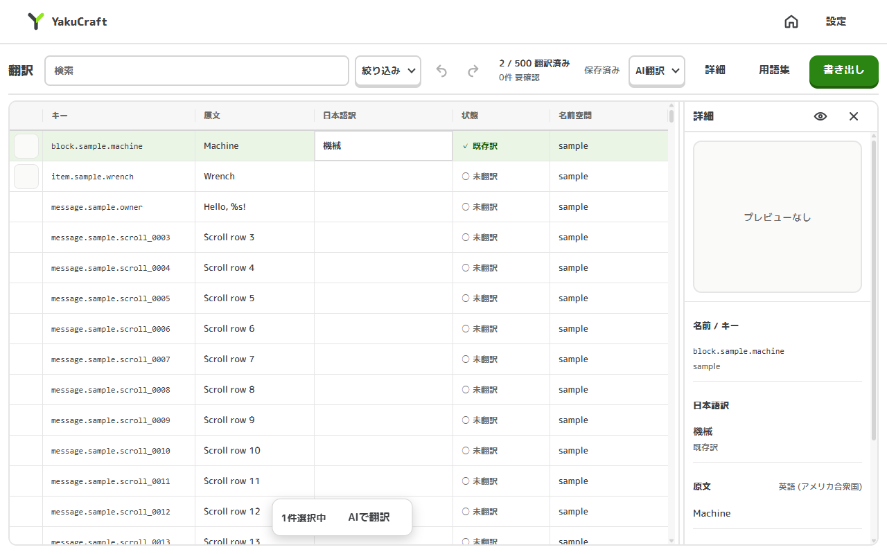

# YakuCraft

Windows 向けの Minecraft Mod 翻訳アプリです。JAR やインスタンス内の Mod を調べ、日本語の言語ファイルを書き出します。



## 主な機能

- Mod JAR の翻訳データを編集し、最近のプロジェクトから再開
- インスタンスの Mod フォルダをまとめて確認し、選んだ Mod を翻訳
- AI 翻訳、検索、翻訳状態の確認、Minecraft のブロックやアイテムのプレビュー
- リソースパック、言語ファイル、Mod JAR への書き出し

## ダウンロードとインストール

[GitHub Releases](https://github.com/yoima-jp/YakuCraft/releases) から最新版のセットアップファイルをダウンロードしてください。通常は `YakuCraft_*_x64-setup.exe` を使います。MSI も配布します。

コード署名を行っていないため、Windows SmartScreen の警告が表示されることがあります。発行元とダウンロード元を確認して実行する場合は、警告画面の「詳細情報」から「実行」を選んでください。セットアップ中に WebView2 Runtime が必要な場合は、インターネットから取得します。

## 使い方

### 1つの JAR を翻訳

ホーム画面で JAR を選ぶか、画面へドロップします。解析内容と翻訳元の言語を確認し、翻訳画面で日本語を編集します。編集内容は自動保存されます。

### インスタンス内の Mod をまとめて翻訳

ホーム画面で Minecraft インスタンスのフォルダを選び、検出された Mod を選択します。対象 Mod ごとに翻訳データを編集できます。インスタンスを検出できない場合、一部の直接配置機能は使えません。

### 書き出し

- **リソースパック**: 選んだ Mod の翻訳を ZIP にまとめます。Minecraft のリソースパック設定で有効にしてください。
- **インスタンスへ配置**: リソースパックを検出したインスタンスへ直接配置します。インスタンスを検出できない場合は選べません。
- **言語ファイル**: `assets/<namespace>/lang/` に置く言語ファイルを書き出します。Minecraft が読み込む場所へ手動で配置してください。
- **Mod JAR**: 翻訳を追加した JAR を書き出します。通常は元ファイルを変更しません。`mods` フォルダの JAR を直接置き換える方法を選ぶ場合は、Minecraft を終了してください。元の JAR はバックアップされ、アプリから戻せますが、ランチャーの更新や整合性確認で変更が戻る場合があります。

## AI 翻訳

ChatGPT、OpenAI、OpenAI 互換 API、DeepL に対応しています。API キーと ChatGPT のログイン資格情報は Windows 資格情報マネージャーに保存します。

用語集は CSV / TSV で取り込めます。列は「原文、訳語、メモ、大小区別」の順で、大小区別は `true` / `false` を指定します。メモと大小区別は省略できます。CSV の書き出しには大小区別も含まれます。

## 生成物の再配布

Mod の翻訳を含むリソースパックや JAR を配布する前に、各 Mod のライセンスと配布条件を確認してください。再配布できるかどうかは各 Mod のライセンスに従います。

## 開発者向け

### 必要な環境

- Windows
- Node.js 22.12 以上（CI は Node.js 24 LTS）と npm
- Rust stable と Cargo
- WebView2 Runtime と Tauri の Windows 開発用ツール

### 開発とチェック

```powershell
npm ci
npm run tauri dev
```

```powershell
npm run check:version
npm run typecheck
npm run lint
npm test
cargo fmt --all -- --check
cargo clippy --workspace --all-targets -- -D warnings
cargo test --workspace
```

Windows で WebView2 Runtime と Microsoft Edge WebDriver を使える場合は、E2E を実行できます。必要な `tauri-driver` と WebDriver はスクリプトが準備します。

```powershell
npm run test:e2e
npm run test:e2e:screens
```

配布物に同梱するフォントなどのライセンスは [THIRD_PARTY_NOTICES.md](THIRD_PARTY_NOTICES.md) に記載しています。依存や同梱物を追加・更新するときはライセンス条件を確認し、必要な通知を更新してください。リリースは `v*` タグでビルドされ、GitHub Release の draft として作成されます。公開前に成果物とリリースノートを確認してください。

## ライセンス

YakuCraft のコードは [MIT License](LICENSE) で公開します。同梱フォントには別のライセンスが適用されます。詳細は [THIRD_PARTY_NOTICES.md](THIRD_PARTY_NOTICES.md) を参照してください。
